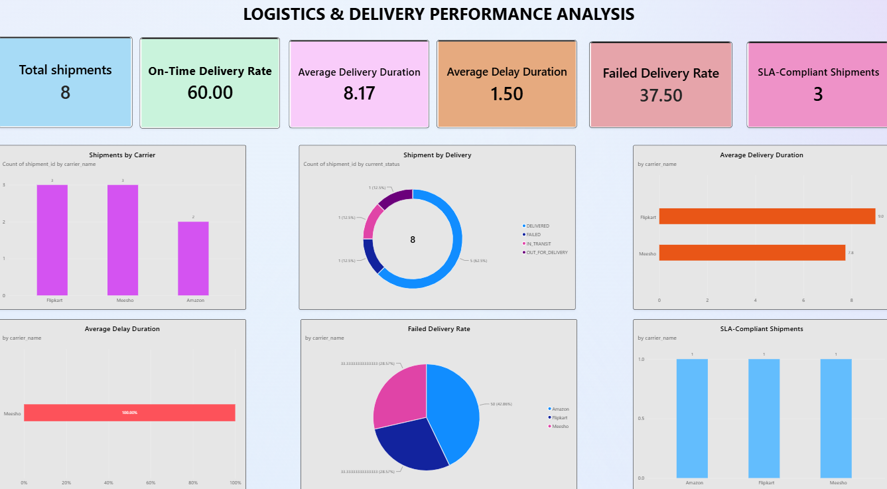

# Logistics and Delivery Performance Analysis

## Project Overview
This project focuses on analyzing last-mile delivery operations to evaluate shipment performance, delivery efficiency, carrier performance, and Service Level Agreement (SLA) compliance.

The objective is to identify delivery delays, failed delivery attempts, and operational inefficiencies using SQL and Power BI.

## Tools and Technologies
- MySQL
- MySQL Workbench
- Microsoft Power BI
- SQL

## Dataset Overview
The project uses a relational database containing 9 tables covering shipment details, carriers, customers, routes, hubs, regions, delivery attempts, and shipment events.

## SQL Analysis
SQL was used to analyze:

- Total shipments handled by each carrier.
- Average delivery duration.
- On-time and delayed shipments.
- Delivery delay duration.
- Carrier and regional performance.
- Weekday and shipment-type analysis.
- Failed delivery attempts.
- Estimated versus actual delivery time.
- SLA compliance.
- Missing timestamps and duplicate records.

## SQL Concepts Used
- SELECT and WHERE
- GROUP BY and ORDER BY
- Aggregate functions (COUNT, SUM, AVG)
- JOIN operations
- CASE statements
- Date and time functions
- Data validation

## Power BI Dashboard
### Dashboard Preview

An interactive Power BI dashboard was developed to visualize shipment performance and delivery efficiency.

### Key Performance Indicators (KPIs)
- On-Time Delivery Rate
- Average Delivery Duration
- Average Delay Duration
- Failed Delivery Rate
- Failed Delivery Attempts
- Total Shipments

### Dashboard Insights
- Compared carrier performance.
- Identified delayed shipments.
- Evaluated delivery success and failure rates.
- Analyzed regional delivery performance.
- Monitored SLA compliance.

## Key Learnings
- Working with relational databases.
- Writing SQL queries for operational analysis.
- Analyzing shipment and delivery data.
- Creating interactive Power BI dashboards.
- Converting raw data into meaningful business insights.

## Project Author
** Thota Sowjanya **
